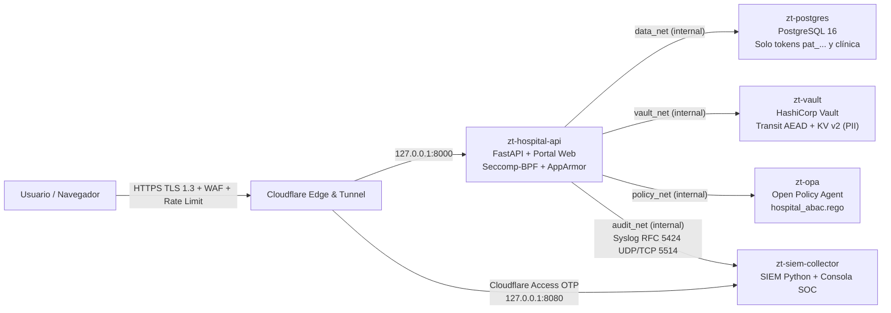

# Documentación Técnica del Sistema
## Plataforma Empresarial Hospitalaria Privacy-by-Design con Zero Trust y Auditoría SIEM

---

| Campo | Detalle |
| :--- | :--- |
| **Institución** | Benemérita Universidad Autónoma de Puebla (BUAP) |
| **Facultad** | Facultad de Ciencias de la Computación (FCC) |
| **Programa Educativo** | Ingeniería en Ciberseguridad |
| **Asignatura** | Privacidad y Seguridad de los Datos Personales (ICSA 252) |
| **Proyecto Final** | Plataforma Empresarial Privacy-by-Design con Zero Trust y Auditoría SIEM |
| **Autores** | **Ubaldo Edgar Gonzalez Flores** (Seguridad en Aplicaciones e Infraestructura)<br>**Jezreel Pérez Romero** (Arquitecto de Privacidad y Ciclo de Vida)<br>**Samuel Pérez Rodríguez** (Analista SOC y Auditoría SIEM) |
| **Dominio Productivo** | `https://tralaleritosmigajeros.uk` · `https://siem.tralaleritosmigajeros.uk` |
| **Fecha de Entrega** | 1 de diciembre de 2026 |

---

## Tabla de Contenido

1. [Resumen Ejecutivo y Planteamiento](#1-resumen-ejecutivo-y-planteamiento)
2. [Arquitectura del Sistema y Segmentación Zero Trust](#2-arquitectura-del-sistema-y-segmentación-zero-trust)
3. [Módulo A — Gobernanza, Identidad, Bóveda PII y Control ABAC](#3-módulo-a--gobernanza-identidad-bóveda-pii-y-control-abac)
4. [Módulo B — Ciclo de Vida, Desidentificación y Borrado Certificado](#4-módulo-b--ciclo-de-vida-desidentificación-y-borrado-certificado)
5. [Módulo C — Confinamiento (Sandboxing) y Auditoría SIEM / SOC](#5-módulo-c--confinamiento-sandboxing-y-auditoría-siem--soc)
6. [DevSecOps, Pruebas Automatizadas y Endurecimiento Perimetral](#6-devsecops-pruebas-automatizadas-y-endurecimiento-perimetral)
7. [Evidencias de Verificación en Producción y Máquina Virtual](#7-evidencias-de-verificación-en-producción-y-máquina-virtual)
8. [Matriz de Cumplimiento de Rúbrica y Conclusiones](#8-matriz-de-cumplimiento-de-rúbrica-y-conclusiones)

---

## 1. Resumen Ejecutivo y Planteamiento

El presente documento describe el diseño, implementación y validación de una **Plataforma Empresarial de Gestión Hospitalaria** construida bajo los principios de **Privacidad desde el Diseño (*Privacy-by-Design*)** y arquitectura de **Confianza Cero (*Zero Trust*)**. El entorno hospitalario maneja datos personales especialmente sensibles (diagnósticos médicos CIE-10, edad, código postal, CURP, NSS y datos de contacto), por lo que un enfoque tradicional basado únicamente en defensa perimetral resulta insuficiente frente a compromisos internos, exfiltración de bases de datos o desvío de finalidad (*Function Creep*).

La solución integra de manera nativa:

1. **Identidad fuerte y verificación continua (`MA-01`):** Autenticación resistente al phishing mediante **FIDO2/WebAuthn (Passkeys)** y respaldo con contraseñas robustas **Argon2id** (*salt* único por usuario + *pepper* secreto HMAC-SHA256), más una puerta de autenticación obligatoria en el portal web con visor y generador criptográfico de contraseñas.
2. **Segregación física y criptográfica de PII (`MA-02`):** Aislamiento de identificadores directos en **HashiCorp Vault** (cifrado autenticado **Transit AEAD** + **KV v2**), manteniendo en **PostgreSQL 16** exclusivamente tokens opacos aleatorios (`pat_<32 hex>`) y atributos clínicos.
3. **Autorización contextual ABAC/OPA (`MA-03` y `MA-04`):** Motor **Open Policy Agent (OPA)** en modo *Fail-Closed* que valida identidad, rol y propósito declarado (`X-Purpose`) en cada operación, aplicando minimización cuantitativa (filtrado de columnas) y cualitativa (enmascaramiento y generalización).
4. **Ciclo de vida y cumplimiento normativo (`MB-01` a `MB-04`):** Purga automática por retención temporal (**TTL**), exportación estadística bajo **HIPAA Safe Harbor** (18 identificadores) con garantía matemática de **$k$-anonimato** y **$l$-diversidad**, y ejecución de **Derechos ARCO** con sanitización **NIST SP 800-88** (`CLEAR`/`PURGE`), limpieza de memoria RAM y emisión de certificados JSON/PDF sellados con **SHA-256**.
5. **Confinamiento del sistema y visibilidad SOC (`MC-01` a `MC-04`):** Perfiles personalizados **Seccomp-BPF** (default-deny `EPERM`) y **AppArmor** (`enforce`), centralización de auditoría en formato **Syslog RFC 5424** sobre UDP/TCP, sanitización Regex previa a persistencia (tarjetas Luhn, CURP, NSS, contraseñas y JWT) y un **SIEM en Python** con 3 reglas de correlación temporal en tiempo real.
6. **Exposición segura sin puertos públicos (`F5-03` y `F5-04`):** Publicación a través de **Cloudflare Tunnel (`cloudflared`)** hacia `tralaleritosmigajeros.uk`, reforzada con TLS 1.3 Strict, 4 reglas WAF personalizadas, Rate Limiting en `/auth/` y **Cloudflare Zero Trust Access (Email OTP)** protegiendo `siem.tralaleritosmigajeros.uk`.

---

## 2. Arquitectura del Sistema y Segmentación Zero Trust

### 2.1 Topología de Contenedores y Redes Aisladas

La plataforma se despliega en **Ubuntu Server 26.04.1 LTS** mediante Docker Compose (`docker-compose.yml` y `docker-compose.apparmor.yml`), aislando **5 servicios** en **5 redes virtuales independientes**. Cuatro de las cinco redes están declaradas con `internal: true`, lo que bloquea a nivel de kernel cualquier salida a Internet o movimiento lateral entre contenedores que no necesiten comunicarse.



### 2.2 Inventario de Servicios y Controles de Endurecimiento

| Contenedor | Tecnología | Redes Conectadas | Exposición Host | Controles de Endurecimiento |
| :--- | :--- | :--- | :--- | :--- |
| **`zt-hospital-api`** | Python 3.11 + FastAPI | `edge_net`, `data_net`, `vault_net`, `policy_net`, `audit_net` | `127.0.0.1:8000` | Usuario no-root (`appuser`), `read_only: true`, `cap_drop: [ALL]`, `no-new-privileges:true`, **Seccomp-BPF** (`api-seccomp.json`), **AppArmor** (`zt-hospital-api`), `tmpfs` limitado en `/tmp`. |
| **`zt-postgres`** | PostgreSQL 16 Alpine | `data_net` (`internal`) | Ninguna | Sin puertos al exterior; esquemas segregados (`identity`, `clinical`, `compliance`); sin PII directa en tablas clínicas. |
| **`zt-vault`** | HashiCorp Vault 1.17 | `vault_net` (`internal`) | Ninguna | Sin puertos al exterior; motor `Transit` (AEAD AES-256-GCM96 con rotación de llaves) + `KV v2` para almacenar PII cifrada. |
| **`zt-opa`** | Open Policy Agent | `policy_net` (`internal`) | Ninguna | Sin puertos al exterior; política `hospital_abac.rego` montada en modo solo lectura (`:ro`). |
| **`zt-siem-collector`** | Python 3.11 + FastAPI + SQLite | `edge_net`, `audit_net` (`internal`) | `127.0.0.1:8080` | Ingesta Syslog RFC 5424 (`5514/udp` y `5514/tcp`) solo en `audit_net`; consola SOC protegida por **Cloudflare Zero Trust Access**. |

### 2.3 Defensa en Profundidad en Cabeceras HTTP

El middleware `SecurityHeadersMiddleware` (`services/api/app/middleware.py`) inyecta en todas las respuestas cabeceras Zero Trust:

- `Strict-Transport-Security: max-age=31536000; includeSubDomains; preload`
- `Content-Security-Policy: default-src 'self'; script-src 'self'; style-src 'self'; img-src 'self' data:; connect-src 'self'; frame-ancestors 'none'; base-uri 'self'; form-action 'self'` (sin `unsafe-inline`)
- `X-Content-Type-Options: nosniff` · `X-Frame-Options: DENY` · `Referrer-Policy: no-referrer`
- `Cache-Control: no-store, no-cache, must-revalidate, max-age=0` (evita persistir datos clínicos en caché del navegador o proxies)
- `X-Request-ID` único por petición para trazabilidad en el SIEM.
- **Protección de OpenAPI / Swagger UI (OWASP A05 / API9):** Las rutas `/docs`, `/redoc` y `/openapi.json` permanecen **deshabilitadas por defecto** (`EXPOSE_OPENAPI_DOCS=false`) para evitar reconocimiento de superficie de ataque por usuarios no autenticados.

---

## 3. Módulo A — Gobernanza, Identidad, Bóveda PII y Control ABAC

### 3.1 Autenticación Robusta y Gestión de Identidades (`MA-01`)

Implementada en `services/api/app/routers/auth.py`, `services/api/app/security/passwords.py`, `services/api/app/security/webauthn_service.py` y `services/api/app/security/jwt_auth.py`:

- **Argon2id con Salt único + Pepper secreto:** Parámetros endurecidos (`$argon2id$v=19$m=65536,t=3,p=2`, 64 MiB de memoria). Antes de aplicar Argon2id, se antepone un *pepper* secreto derivado por `HMAC-SHA256` (`ARGON2_PEPPER`), de modo que un volcado de la base de datos no permite ataques offline sin comprometer también el secreto de aplicación.
- **Mitigación de enumeración de usuarios (Timing Attack):** Si el usuario no existe, se ejecuta `verify_dummy()` contra un hash Argon2id real para igualar el tiempo de respuesta.
- **Política de contraseñas OWASP A07 y mínimo privilegio en registro:** Mínimo 12 caracteres, máximo 128, exigiendo mayúscula, minúscula, dígito y símbolo (`UserRegisterRequest.validate_password_strength`). El auto-registro público (`POST /auth/register`) está restringido estrictamente al rol `paciente` (cualquier intento de escalar a roles institucionales retorna `403` y genera alerta `AUTH_PRIVILEGE_ESCALATION_BLOCKED` en el SIEM). En el portal web (`services/api/app/static/`), se integró puerta de acceso obligatoria (`#auth-gate`), visor de contraseña y **generador criptográfico de 16 caracteres** basado en `window.crypto.getRandomValues`.
- **Gestión de Cuentas y Roles (IAM sin `super_admin`):** Bajo Zero Trust no existe ninguna cuenta `super_admin` con privilegios universales. El rol `admin_sec` concentra SecOps e IAM mediante `GET/POST /auth/users`, `PATCH /auth/users/{id}` y `POST /auth/users/{id}/revoke-sessions` (y la pestaña *6. Gestión de Cuentas*) para aprovisionar personal institucional, cambiar roles, suspender cuentas y revocar sesiones activas en tiempo real. Por **Separación de Funciones Zero Trust**, `admin_sec` carece deliberadamente de acceso a datos clínicos, bóveda PII, exportaciones o borrado ARCO (`HTTP 403`).
- **FIDO2 / WebAuthn (Passkeys):** Flujos completos de registro (`/auth/webauthn/register/{begin,complete}`) y login *passwordless* (`/auth/webauthn/login/{begin,complete}`) usando criptografía asimétrica **ECDSA P-256**, retos criptográficos de un solo uso (*anti-replay*), verificación de origen (`rp_id`) y contador monotónico `sign_count` (*anti-clonación*).
- **Sesiones JWT Zero Trust con Timeout Implícito de Inactividad (2 minutos):** Firma `HS256` (rechaza `alg: none`), TTL máximo de 30 minutos, **expiración implícita en el backend tras 2 minutos (120 s) de inactividad** (`SESSION_INACTIVITY_TIMEOUT_SECONDS=120`, sin contador visible ni manipulable en la interfaz del cliente), reclamos `sub`, `role` y `amr` (`["pwd"]` = contraseña Argon2id, o `["webauthn", "fido2"]` = Passkey), almacenamiento exclusivo en RAM y revocación inmediata por `jti` en `POST /auth/logout`.

### 3.2 Segregación de Datos y Bóveda de Tokenización (`MA-02`)

Implementada en `services/api/app/vault/service.py`, `services/api/app/routers/vault.py` y `services/api/app/routers/clinical.py`:

- **Aislamiento de PII directa:** El endpoint `POST /clinical/records/segregated` valida primero por Regex que el resumen clínico (`diagnosis_summary`) no contenga accidentalmente CURP, NSS ni correos electrónicos (`HTTP 422` si se detectan).
- **Cifrado Transit AEAD + KV v2:** Los identificadores directos (`full_name`, `curp`, `nss`, `email`, `phone`) se cifran mediante el motor **Transit** de HashiCorp Vault (`hospital-pii-key`) y el texto cifrado resultante (`vault:v1:...`) se almacena en **KV v2** indexado por un token opaco aleatorio `pat_<32 hex>` (128 bits de entropía).
- **Separación estricta de funciones en detokenización:** `GET /vault/patients/{token}` está restringido exclusivamente al rol `medico`; los demás roles (`admin_sec`, `auditor_arco`, `enfermeria`, `analista` y `paciente`) reciben `403 Forbidden` al intentar detokenizar PII.
- **Atomicidad y compensación:** PostgreSQL almacena únicamente `opaque_patient_token` y los atributos clínicos (`age_years`, `zip_prefix`, `gender`, `diagnosis_cie10`, `diagnosis_summary`, `department`). Si la escritura en PostgreSQL falla, la API ejecuta compensación automática destruyendo el token huérfano en Vault.
- **Rotación de llaves sin indisponibilidad:** `POST /vault/keys/rotate` (exclusivo `admin_sec`) rota la clave Transit (ej. versión `1 → 2`) manteniendo descifrables los tokens previos sin reexponer texto plano.

### 3.3 Prevención de *Function Creep* con OPA/ABAC (`MA-03`)

Implementada en `infra/opa/policies/hospital_abac.rego` y `services/api/app/policy/opa_client.py`:

- **Evaluación Fail-Closed:** Toda petición a `/clinical/*` y `/lifecycle/*` consulta el punto de decisión de políticas (`POST /v1/data/hospital/authz/decision` en `zt-opa`). Si OPA no responde, devuelve error o falta la cabecera `X-Purpose`, la petición se deniega automáticamente (`403 Forbidden`).
- **Reglas anti-desvío de finalidad:** Cada rol solo puede operar bajo su propósito legítimo. Por ejemplo, un `medico` que intente consultar expedientes con `X-Purpose: marketing_comercial` o sin propósito recibe `403`, y el evento `OPA_POLICY_DENIED` se envía al SIEM.
- **Separación de funciones y anti-singularización:** `admin_sec` tiene prohibido leer expedientes clínicos (`403`); `analista` tiene prohibido consultar un expediente individual (`GET /clinical/records/{id}`) o filtrar por token para impedir la reidentificación por singularización (*singling-out*).

### 3.4 Minimización Cuantitativa y Cualitativa (`MA-04`)

Implementada en `services/api/app/policy/minimization.py` a partir de la lista `allowed_fields` devuelta dinámicamente por OPA:

| Rol (`role`) | `X-Purpose` Válido | Minimización Cuantitativa (Columnas) | Minimización Cualitativa (Transformación) |
| :--- | :--- | :--- | :--- |
| **`medico`** | `atencion_medica` | Expediente clínico completo + `opaque_patient_token`. | Sin PII directa en tabla clínica; requiere detokenización explícita y auditada en Vault. |
| **`enfermeria`** | `atencion_medica` | Solo 4 campos: `record_id`, `opaque_patient_token`, `department`, `diagnosis_summary`. | Token enmascarado (`pat_21a0...ae72`); oculta edad, CP y código CIE-10 exacto. |
| **`analista`** | `investigacion_estadistica` | `age_range`, `zip_generalized`, `gender`, `diagnosis_cie10`, `department`. | Generalización: edad en rangos decenales (`30-39`, tope `90+`) y CP truncado (`72***`); sin `record_id` ni tokens. |
| **`auditor_arco`** | `ejercicio_arco` | Solo metadatos de cumplimiento (`record_id`, `opaque_patient_token`, `purpose_scope`, `is_sanitized`, `ttl_expires_at`). | Cero visibilidad de diagnósticos ni resúmenes clínicos. |
| **`admin_sec`** | `mantenimiento_ttl` | Ninguna columna clínica (`403` en `/clinical/records`). | Separación estricta de funciones SecOps vs. datos clínicos. |
| **`paciente`** | `acceso_titular` | Solo sus propios registros (`resource_owner_match == true`). | Oculta identificadores internos y registros de terceros. |

---

## 4. Módulo B — Ciclo de Vida, Desidentificación y Borrado Certificado

### 4.1 Retención Temporal Automatizada (`MB-01`)

Implementada en `services/api/app/lifecycle/ttl_scheduler.py` y `services/api/app/routers/lifecycle.py`:

- Cada expediente almacena una marca de expiración `ttl_expires_at`.
- Un planificador asíncrono (`TTLBackgroundScheduler`) arrancado en el ciclo `lifespan` de FastAPI —y también invocable bajo demanda en `POST /lifecycle/ttl/sweep` por `auditor_arco` o `admin_sec`— identifica registros vencidos, sobrescribe sus campos sensibles en PostgreSQL, los elimina y purga el token huérfano correspondiente en Vault KV v2.

### 4.2 Exportación Desidentificada: Safe Harbor + $(k, l)$ (`MB-02`)

Implementada en `services/api/app/lifecycle/anonymizer.py`:

- **HIPAA Safe Harbor:** Remueve los 18 identificadores directos/indirectos (nombres, fechas exactas, CP completo, teléfonos, correos, CURP, NSS, identificadores de expediente) y aplica tope superior `90+` para edades $\ge 90$ años.
- **$k$-anonimato y $l$-diversidad con retícula adaptativa:** Agrupa cuasi-identificadores (`age_range`, `zip_generalized`, `gender`) en clases de equivalencia, buscando automáticamente el nivel mínimo de generalización donde cada clase tenga al menos **$k$ registros indistinguibles** y al menos **$l$ diagnósticos CIE-10 distintos**.
- **Comportamiento Fail-Closed:** Si el dataset no puede satisfacer los umbrales $(k, l)$ dentro del límite de supresión permitido (`suppression_limit`), el endpoint (`POST /lifecycle/exports/anonymized` y `GET /lifecycle/exports/anonymized.csv`) rechaza la exportación con `HTTP 422` en lugar de liberar datos reidentificables.

### 4.3 Derechos ARCO y Sanitización NIST SP 800-88 (`MB-03`)

Implementada en `services/api/app/lifecycle/erasure.py`:

Al invocar `POST /lifecycle/arco/erasure` (rol `auditor_arco`, `X-Purpose: ejercicio_arco`), la plataforma ejecuta una secuencia determinista de destrucción irreversible:

1. **Sobrescritura multi-pasada en PostgreSQL:**
   - `NIST_800_88_CLEAR`: 2 pasadas de sobrescritura sobre los campos clínicos antes de marcar/purgar el registro.
   - `NIST_800_88_PURGE`: 3 pasadas (patrones pseudoaleatorios + ceros) más destrucción definitiva de datos sensibles.
2. **Limpieza segura de memoria RAM (`secure_zero_buffer`):** Sobrescribe con ceros los buffers mutables (`bytearray`) que contuvieron información sensible durante la operación para mitigar exposición residual en memoria.
3. **Purga criptográfica en Vault KV v2:** Ejecuta `DELETE` permanente de metadatos y todas las versiones del secreto en Vault, verificando mediante una lectura posterior el estado `CONFIRMED_NOT_FOUND` (`HTTP 404`).

### 4.4 Certificados de Sanitización con Sello SHA-256 (`MB-04`)

Implementada en `services/api/app/lifecycle/certificates.py`:

- Tras cada borrado ARCO exitoso, se persiste un certificado inmutable en `compliance.sanitization_certificates` con un digest **`SHA-256`** calculado sobre la representación canónica JSON del evento (ID de certificado, token purgado, método NIST, número de pasadas, verificación de Vault, actor y marca temporal UTC).
- Descargable en formato **JSON** (`/lifecycle/certificates/{id}.json`) y **PDF** profesional generado con `reportlab` (`/lifecycle/certificates/{id}.pdf`).
- Verificación de integridad en tiempo constante (`/lifecycle/certificates/{id}/verify`) mediante `hmac.compare_digest`, capaz de detectar cualquier alteración (*tampering*) en base de datos.

```json
{
  "certificate_id": "c5394a18-300e-4f4b-a106-f87eb9db6543",
  "standard": "NIST SP 800-88 Rev. 1",
  "method": "NIST_800_88_PURGE",
  "overwrite_passes": 3,
  "memory_buffer_zeroed": true,
  "vault_purge_status": "CONFIRMED_NOT_FOUND",
  "records_sanitized": 1,
  "sha256_integrity_hash": "351b79123356...",
  "verified": true
}
```

---

## 5. Módulo C — Confinamiento (Sandboxing) y Auditoría SIEM / SOC

### 5.1 Confinamiento del Contenedor: Seccomp-BPF y AppArmor (`MC-01`)

Implementado en `infra/seccomp/api-seccomp.json`, `infra/apparmor/zt-hospital-api`, `docker-compose.apparmor.yml` e `infra/scripts/install-apparmor-profile.sh`:

- **Perfil Seccomp-BPF personalizado (Default-Deny `SCMP_ACT_ERRNO` / `EPERM`):** Permite exclusivamente las llamadas al sistema mínimas requeridas por el runtime Python/FastAPI y bloquea explícitamente `fork`, `vfork`, `execve`/`subprocess`, `mount`, `unshare`, `ptrace`, `chmod` y sockets crudos `AF_PACKET` (*sniffing*).
- **Perfil AppArmor (`zt-hospital-api` en modo `enforce`):** Restringe acceso a rutas del sistema de archivos, bloquea escritura fuera de `/tmp`, impide ejecución de shells y confina capacidades del proceso a nivel de kernel Linux.
- **Hardening complementario de Docker:** `read_only: true`, `cap_drop: [ALL]`, `no-new-privileges:true` y usuario sin privilegios (`appuser`).

### 5.2 Centralización de Auditoría Syslog RFC 5424 (`MC-02`)

Implementado en `services/api/app/audit/syslog_client.py` y `services/siem/app/` (`syslog_server.py`, `rfc5424.py`, `storage.py`):

- La API transmite eventos estructurados (`AUTH_LOGIN_SUCCESS`, `AUTH_LOGIN_FAILED`, `CLINICAL_RECORD_CREATED`, `CLINICAL_RECORDS_READ`, `CLINICAL_PII_DETOKENIZE`, `OPA_POLICY_DENIED`, `LIFECYCLE_ARCO_ERASURE`, `VAULT_KEY_ROTATED`) en formato **RFC 5424** con `STRUCTURED-DATA` (`[audit@55555 actor="..." role="..." action="..." outcome="..." request_id="..."]`) hacia `zt-siem-collector:5514` sobre **UDP y TCP**.
- **Defensa contra *Log Forging* (CWE-117):** Los saltos de línea (`\r`, `\n`) y caracteres de control son neutralizados antes de ensamblar la trama Syslog.

### 5.3 Sanitización Regex Previa a Persistencia (`MC-03`)

Implementada en `services/siem/app/sanitizer.py`:

Antes de insertar cualquier evento en la base SQLite del SIEM, el pipeline aplica ofuscación determinista con `***` tanto en el mensaje libre como en cada parámetro de `STRUCTURED-DATA`:

| Dato Sensible Detectado | Mecanismo de Detección | Resultado Persistido |
| :--- | :--- | :--- |
| **Tarjetas bancarias (PAN)** | Regex de 13–19 dígitos + validación matemática de **algoritmo de Luhn** | `[REDACTED_CARD:***]` |
| **CURP mexicana** | Patrón oficial de 18 caracteres alfanuméricos | `[REDACTED_CURP:***]` |
| **NSS (IMSS)** | Patrón contextual de 11 dígitos | `[REDACTED_NSS:***]` |
| **Tokens JWT** | Patrón `eyJ...\.eyJ...\....` | `[REDACTED_JWT:***]` |
| **Contraseñas / Secretos** | Claves sensibles (`password`, `secret`, `token`, `api_key`, `authorization`) | `***` |

### 5.4 Motor de Correlación Temporal y Consola SOC (`MC-04`)

Implementado en `services/siem/app/correlator.py` y `services/siem/app/dashboard.py`:

El motor evalúa ventanas deslizantes en memoria en tiempo real y emite alertas consultables y reconocibles (`POST /api/v1/alerts/{id}/ack`) desde la consola SOC (`https://siem.tralaleritosmigajeros.uk`):

| ID Regla | Código de Alerta | Severidad | Condición de Disparo | Propósito Defensivo |
| :--- | :--- | :---: | :--- | :--- |
| **`RULE-001`** | `BRUTE_FORCE_LOGIN` | `HIGH` | $\ge 5$ eventos `AUTH_LOGIN_FAILED` en **60 s** por actor/IP | Detección de fuerza bruta y *credential stuffing*. |
| **`RULE-002`** | `MASS_RECORD_ACCESS` | **`CRITICAL`** | $\ge 10$ consultas clínicas o $\ge 25$ expedientes accedidos en **60 s** por un mismo actor | Detección de exfiltración masiva o compromiso de cuenta interna. |
| **`RULE-003`** | `REPEATED_POLICY_DENIAL` | `HIGH` | $\ge 5$ eventos `OPA_POLICY_DENIED` en **120 s** | Detección de intentos reiterados de *Function Creep* o escalación de privilegios. |

---

## 6. DevSecOps, Pruebas Automatizadas y Endurecimiento Perimetral

### 6.1 Suite de Pruebas Automatizadas y Pipeline CI/CD (`F5-01` y `F5-02`)

El repositorio cuenta con **38+ pruebas automatizadas en `pytest`** distribuidas en `tests/` (`test_auth_ma01.py`, `test_vault_ma02.py`, `test_privacy_module_a.py`, `test_lifecycle_module_b.py`, `test_sandboxing_mc01.py`, `test_siem_module_c.py`, `test_owasp_top10_security.py`, `test_security_headers.py`, `test_health.py`), alcanzando **82% de cobertura global y >90% en el SIEM**.

El pipeline de GitHub Actions (`.github/workflows/ci.yml` y `.github/workflows/security-owasp.yml`) ejecuta **9 controles automatizados en verde**:

1. **Ruff** (calidad de código y formato Python).
2. **Pytest + Coverage** (pruebas funcionales, seguridad y OWASP Top 10 A01–A10).
3. **OPA Check (`--strict`) y `opa test`** (13/13 pruebas unitarias de `hospital_abac.rego`).
4. **ShellCheck** sobre todos los scripts de infraestructura (`infra/scripts/*.sh`).
5. **Validación de Sandboxing** (`apparmor_parser` + prueba negativa Docker con Seccomp-BPF).
6. **pip-audit** (0 CVEs conocidos tras remediación de dependencias).
7. **Bandit** (análisis estático SAST Python, 0 hallazgos).
8. **Semgrep (OWASP Top 10)** + **Gitleaks** (detección de secretos) + **Trivy** + **CodeQL v4**.
9. **Dependabot** configurado con ventana de enfriamiento (*cooldown*) de 7 días.

### 6.2 Cloudflare Tunnel y Endurecimiento del Dominio (`F5-03` y `F5-04`)

La publicación hacia `tralaleritosmigajeros.uk` se realiza mediante **`cloudflared`** con 4 conexiones activas (`readyConnections: 4`), eliminando la necesidad de abrir puertos entrantes en el firewall del servidor:

- **SSL/TLS Full (Strict)** + **TLS 1.3** + **HSTS (1 año, `includeSubDomains`)** + redirección forzada HTTP → HTTPS (`301`).
- **4 Reglas WAF Personalizadas:** bloqueo de archivos sensibles (`/.env`, `/.git`, `/wp-admin`, `..`), sondas SQLi/XSS, métodos HTTP no permitidos y peticiones sin `User-Agent`.
- **Rate Limiting:** Protección dedicada en `/auth/*` (`10 req / 10 s` por IP → `Block`).
- **Cloudflare Zero Trust Access:** La consola SIEM (`siem.tralaleritosmigajeros.uk`) exige autenticación previa por **Email One-Time PIN (OTP)** restringida exclusivamente a las **cuentas institucionales BUAP** (`@alumno.buap.mx` / `@correo.buap.mx`) autorizadas del equipo SOC.

---

## 7. Evidencias de Verificación en Producción y Máquina Virtual

Todas las verificaciones end-to-end fueron ejecutadas sobre el despliegue real en Ubuntu Server 26.04.1 LTS y el dominio público `https://tralaleritosmigajeros.uk`, quedando archivadas en `docs/evidencias/`:

### 7.1 Resumen de Ejecuciones Automatizadas E2E

| Script de Verificación | Alcance Validado | Resultado | Archivo de Evidencia |
| :--- | :--- | :---: | :--- |
| `verify-domain-security.sh` | HTTPS, `CF-Ray`, cabeceras Zero Trust, TLS $\ge$ 1.2, WAF (`/.env` y SQLi `403`) y Access OTP en `siem.` | **PASS=14 · WARN=0 · FAIL=0** | `docs/evidencias/evidenciaTestbashVM.txt` |
| `verify-sandboxing-mc01.sh` | `ReadonlyRootfs`, `CapDrop=ALL`, `no-new-privileges`, Seccomp (`fork`, `subprocess`, `mount`, `unshare`, `ptrace`, `AF_PACKET`, `chmod` → `EPERM`) y AppArmor `enforce` | **PASS=14 · WARN=0 · FAIL=0** | `docs/evidencias/evidenciainfra.txt` |
| `verify-ma01-ma02.sh` | Aprovisionamiento IAM, login Argon2id+JWT, WebAuthn begin, Vault Transit+KV v2 (`pat_...`), RBAC `403` analista/SecOps, rotación llave `1→2`, purga KV v2 y revocación logout (`401`) | **PASS=14 · FAIL=0** | `docs/evidencias/evidenciainfra.txt` |
| `verify-module-a.sh` | OPA operativo, alta segregada Vault+PG, bloqueos *Function Creep* (`403`) y minimización en `enfermeria`, `analista` y `auditor_arco` | **PASS=9 · FAIL=0** | `docs/evidencias/evidenciasROLprivacidad.txt` |
| `verify-module-b.sh` | Scheduler TTL activo, barrido con purga en Vault, exportación Safe Harbor + $(k=3, l=3)$ JSON/CSV, borrado ARCO NIST 800-88 `PURGE` y certificados JSON/PDF SHA-256 | **PASS=8 · FAIL=0** | `docs/evidencias/evidenciasROLprivacidad.txt` |
| `verify-siem-module-c.sh` | Ingesta Syslog RFC 5424 UDP/TCP, sanitización Regex en SQLite y disparo de alertas `RULE-001`, `RULE-002` y `RULE-003` | **PASS (38/38)** | `tests/test_siem_module_c.py` |

### 7.2 Evidencias Visuales de Endurecimiento en Cloudflare

Las siguientes capturas documentan la transición desde tráfico sin reglas personalizadas hasta la activación efectiva del WAF y Rate Limiting en `tralaleritosmigajeros.uk`:

1. **Línea base sin reglas personalizadas:** `docs/evidencias/trafico sin reglas personalizadas.png`
2. **Configuración de las 4 reglas WAF personalizadas:** `docs/evidencias/armado de 4 reglas personalizadas.png`
3. **Bloqueo activo (`HTTP 403`) ante sonda `/.env`:** `docs/evidencias/bloqueo de env.png`
4. **Rate Limiting activo protegiendo `/auth/`:** `docs/evidencias/ratelimiting activo.png`

---

## 8. Matriz de Cumplimiento de Rúbrica y Conclusiones

| Bloque de Evaluación (Rúbrica ICSA 252) | Peso Rúbrica | Requisitos Cubiertos | Estado |
| :--- | :---: | :--- | :---: |
| **Módulo A:** Gobernanza, Minimización y Control de Acceso | 20% | `MA-01` (WebAuthn + Argon2id/Pepper), `MA-02` (Vault Transit+KV v2), `MA-03` (OPA Fail-Closed), `MA-04` (Minimización cuantitativa/cualitativa) | **100% Completado** |
| **Módulo B:** Ciclo de Vida, Desidentificación y Borrado Certificado | 25% | `MB-01` (TTL automático), `MB-02` (Safe Harbor + $k$-anonimato/$l$-diversidad), `MB-03` (ARCO + NIST SP 800-88 + limpieza RAM), `MB-04` (Certificados JSON/PDF SHA-256) | **100% Completado** |
| **Módulo C:** Sandboxing de Aplicación y Auditoría SIEM | 25% | `MC-01` (Seccomp-BPF + AppArmor), `MC-02` (Syslog RFC 5424), `MC-03` (Sanitización Regex pre-persistencia), `MC-04` (3 reglas de correlación temporal + SOC) | **100% Completado** |
| **Documentación, Evidencias y Defensa Técnica** | 30% | Reporte técnico MD + PDF, guías de defensa por rol (Jezreel, Ubaldo, Samuel) y guion de demo en vivo de 20 minutos | **100% Completado** |

### Conclusiones

La plataforma demuestra que es viable implementar controles rigurosos de **Privacidad desde el Diseño** y **Zero Trust** sin sacrificar usabilidad ni mantenibilidad. La combinación de segregación criptográfica con Vault, autorización declarativa *Fail-Closed* en OPA, anonimización matemática verificable, destrucción certificada NIST SP 800-88, confinamiento de kernel con Seccomp/AppArmor y detección temprana en un SIEM con sanitización previa a persistencia establece múltiples capas independientes de protección (*defensa en profundidad*) frente a amenazas tanto externas como internas en entornos clínicos críticos.
