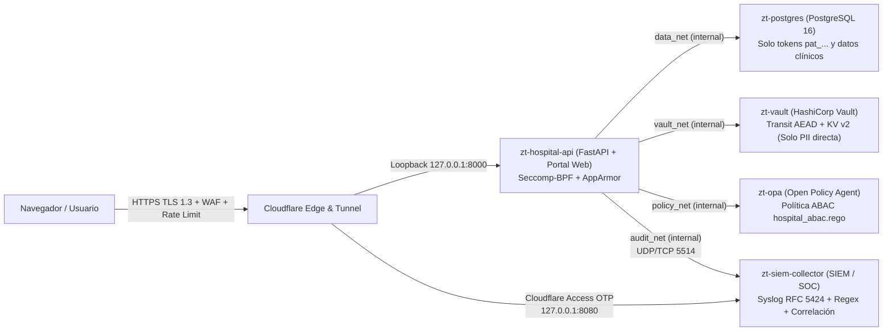

# Guía de Funcionamiento del Sistema — Plataforma Hospitalaria Privacy-by-Design & Zero Trust

- **Institución:** Benemérita Universidad Autónoma de Puebla (BUAP) — Facultad de Ciencias de la Computación (FCC)
- **Asignatura:** Privacidad y Seguridad de los Datos Personales (ICSA 252)
- **Dominio en producción:** `https://tralaleritosmigajeros.uk` (Portal y API) · `https://siem.tralaleritosmigajeros.uk` (Consola SIEM/SOC)

---

## 1. ¿Qué hace este programa?

Esta plataforma es un **Sistema de Gestión Hospitalaria** diseñado bajo los principios de **Privacy-by-Design** y **Zero Trust** (*nunca confiar, siempre verificar*). Su objetivo es administrar expedientes clínicos sin exponer jamás la identidad directa del paciente en la base de datos clínica, impedir el uso indebido de datos (*Function Creep*), permitir exportación estadística matemáticamente anonimizada, ejecutar borrado irreversible certificado (Derechos ARCO / NIST SP 800-88) y auditar cada acción en tiempo real en un SIEM.

### Arquitectura de Contenedores y Redes Aisladas

El sistema se compone de **5 servicios aislados en Docker** comunicados únicamente a través de **5 redes segmentadas** (`edge_net` + 4 redes `internal: true` sin salida a Internet):



> **Principio clave de segregación:** Si alguien robara la base de datos PostgreSQL completa, **no encontraría ningún nombre, CURP, NSS ni correo electrónico**, únicamente tokens opacos aleatorios (`pat_<32 hex>`) y diagnósticos desvinculados. La identidad real vive cifrada aparte dentro de **HashiCorp Vault**.

---

## 2. ¿Cómo funciona el Inicio de Sesión y el Filtro de Entrada?

La aplicación implementa **doble barrera de protección** (en el frontend y en el backend) para que **nadie sin identidad verificada** pueda ver ni operar la plataforma:

1. **Puerta de Autenticación Obligatoria (`#auth-gate`):**
   - Al abrir `https://tralaleritosmigajeros.uk/` (o `/portal`), el usuario **únicamente ve la pantalla de Inicio de Sesión / Registro**.
   - Toda la interfaz operativa (`#app-shell`: menú lateral, expedientes clínicos, bóveda Vault, evaluador OPA, exportador Safe Harbor y borrado ARCO) permanece oculta (`is-hidden`) hasta que el servidor emite un **JWT válido** y lo confirma en `GET /auth/me`.
   - El token JWT se almacena **exclusivamente en memoria RAM** de la pestaña (nunca en `localStorage`). Al cerrar sesión (`POST /auth/logout`) o recibir un `HTTP 401`, el `jti` se revoca en el servidor, se limpian todos los datos del DOM y la interfaz se bloquea inmediatamente de vuelta en la pantalla de login.
2. **Validación estricta en Backend (`HTTP 401` / `HTTP 403`):**
   - Todos los endpoints (`/auth/me`, `/clinical/*`, `/vault/*`, `/lifecycle/*`) exigen cabecera `Authorization: Bearer <JWT>`. Sin token válido o con token revocado/expirado, la API devuelve `401 Unauthorized`.
   - Cualquier intento de acceso con un rol o propósito no permitido devuelve `403 Forbidden` y se registra automáticamente en el SIEM.

### Métodos de Autenticación Soportados (`MA-01`)

| Método | Flujo | Seguridad Aplicada |
| :--- | :--- | :--- |
| **Contraseña (Argon2id)** | `POST /auth/register` → `POST /auth/login` | Contraseña mínima 12 chars (`Aa1!`), hash `Argon2id` (64 MiB, `t=3`, `p=2`), **Salt único** por usuario + **Pepper secreto** de aplicación (`ARGON2_PEPPER`) y verificación *dummy* anti-enumeración. |
| **Passkey FIDO2 / WebAuthn** | Registro: `/auth/webauthn/register/{begin,complete}`<br>Login: `/auth/webauthn/login/{begin,complete}` | Autenticación *passwordless* por llave criptográfica asimétrica (ECDSA P-256) ligada al origen (`tralaleritosmigajeros.uk`), reto de un solo uso (anti-replay) y contador de firma monotónico (anti-clonación). |
| **Sesión JWT Zero Trust** | `GET /auth/me` · `POST /auth/logout` | Algoritmo `HS256` (rechaza `alg: none`), expiración de 30 minutos, claims `sub`, `role`, `amr` (`["pwd"]` o `["webauthn","fido2"]`) y lista de revocación por `jti`. |
| **Cloudflare Zero Trust Access** | Acceso a `https://siem.tralaleritosmigajeros.uk` | Autenticación perimetral por Email OTP en Cloudflare antes de que la petición llegue a la consola SIEM. |

---

## 3. Matriz de Roles ABAC y Prevención de *Function Creep* (`MA-03` y `MA-04`)

Cada petición clínica o de ciclo de vida exige **dos cosas**: tu identidad autenticada (JWT) y la cabecera **`X-Purpose`** declarando el propósito exacto de la consulta. **Open Policy Agent (OPA)** evalúa la política `infra/opa/policies/hospital_abac.rego` en modo **Fail-Closed** (si OPA falla o falta `X-Purpose`, todo se bloquea).

| Rol (`role`) | `X-Purpose` Válido | ¿Qué puede hacer? | Minimización de Datos (`MA-04`) | ¿Qué se le bloquea (`403`)? |
| :--- | :--- | :--- | :--- | :--- |
| **`medico`** | `atencion_medica` | Crear expedientes segregados (Vault+PG), leer/actualizar expedientes y detokenizar PII en Vault. | Ve atributos clínicos completos y token `pat_...` (sin PII directa en la tabla clínica hasta detokenizar). | Cualquier propósito distinto (ej. `marketing_comercial` o vacío), borrado ARCO y exportación Safe Harbor. |
| **`enfermeria`** | `atencion_medica` | Leer listado y detalle clínico asistencial. | **Solo 4 columnas** (`record_id`, `opaque_patient_token`, `department`, `diagnosis_summary`) con **token enmascarado** (`pat_xxxx...yyyy`). | Crear/editar expedientes, detokenizar PII en Vault, ver edad/CP exactos. |
| **`analista`** | `investigacion_estadistica` | Consultar listado generalizado y exportar datasets Safe Harbor + $(k, l)$ en JSON/CSV. | **Generalización automática:** `age_range` (`30-39`, `90+`) y `zip_generalized` (`72***`); sin `record_id` ni `opaque_patient_token`. | **Consulta individual (`GET /clinical/records/{id}`)** o filtro por token (previene *singling-out* / singularización). |
| **`auditor_arco`** | `ejercicio_arco` | Auditar OPA, ejecutar barridos TTL, ejecutar borrado **NIST SP 800-88**, listar/descargar/verificar certificados PDF y JSON. | Ve únicamente metadatos de cumplimiento (`record_id`, `opaque_patient_token`, `purpose_scope`, `is_sanitized`, `ttl_expires_at`), **nunca diagnósticos clínicos**. | Modificar diagnósticos o detokenizar PII clínica para atención. |
| **`admin_sec`** | `mantenimiento_ttl` | Verificar/rotar llaves Transit en Vault, auditar OPA y ejecutar barridos TTL. | **Separación de funciones:** cero acceso a expedientes ni diagnósticos clínicos. | Cualquier lectura de `/clinical/records` (`403 Forbidden`). |
| **`paciente`** | `acceso_titular` | Consultar exclusivamente sus propios registros (`resource_owner_match == true`). | Solo `record_id`, `department`, `diagnosis_summary`, `purpose_scope`, `ttl_expires_at`, `created_at`. | Expedientes de terceros o funciones administrativas. |

---

## 4. Explicación de los 3 Módulos Funcionales

### Módulo A — Gobernanza, Identidad, Bóveda y ABAC (`MA-01` a `MA-04`)
1. **Segregación Atómica (`POST /clinical/records/segregated`):**
   - Recibe `patient_pii` (Nombre, CURP, NSS, correo) y `clinical_data` (edad, CP, género, CIE-10, resumen, departamento).
   - Primero valida por Regex que `diagnosis_summary` **no contenga CURP, NSS ni correos** (si los trae, rechaza con `422`).
   - Envía `patient_pii` a **HashiCorp Vault**, donde se cifra con **Transit AEAD** (`hospital-pii-key`) y se guarda en **KV v2** generando un token `pat_<32 hex>`.
   - Inserta en **PostgreSQL** únicamente el token `pat_...` y `clinical_data`. Si PostgreSQL falla, la API ejecuta compensación automática purgando el token huérfano en Vault.
2. **Resolución de Identidad (`GET /clinical/records/{id}/patient-identity`):**
   - Solo un `medico` con `X-Purpose: atencion_medica` puede resolver momentáneamente la PII desde Vault; el evento queda auditado en el SIEM (`CLINICAL_PII_DETOKENIZE`).

### Módulo B — Ciclo de Vida, Anonimización y Borrado Certificado (`MB-01` a `MB-04`)
1. **Retención Automática TTL (`MB-01`):**
   - Un planificador en segundo plano (`TTLBackgroundScheduler`, configurable en `TTL_SWEEP_INTERVAL_SECONDS`) y el endpoint `POST /lifecycle/ttl/sweep` detectan expedientes cuyo `ttl_expires_at` venció, sobrescriben sus campos, los purgan y eliminan tokens huérfanos en Vault.
2. **Exportación Desidentificada (`MB-02`):**
   - `POST /lifecycle/exports/anonymized` y `GET /lifecycle/exports/anonymized.csv` aplican **HIPAA Safe Harbor** (remoción de los 18 identificadores y tope `90+` en edades) y una retícula adaptativa para garantizar **$k$-anonimato** (al menos $k$ individuos indistinguibles por clase de equivalencia) y **$l$-diversidad** (al menos $l$ diagnósticos CIE-10 distintos por clase).
   - Si el conjunto de datos no puede cumplir $(k, l)$ dentro del `suppression_limit`, responde `422` (**Fail-Closed**) en lugar de exportar datos reidentificables.
3. **Derechos ARCO + NIST SP 800-88 + Certificados (`MB-03` y `MB-04`):**
   - `POST /lifecycle/arco/erasure` ejecuta:
     - Sobrescritura multi-pasada en PostgreSQL (`NIST_800_88_CLEAR`: 2 pasadas; `NIST_800_88_PURGE`: 3 pasadas con datos aleatorios y ceros).
     - Limpieza de buffers sensibles en RAM (`secure_zero_buffer`).
     - Destrucción permanente de versiones y metadatos KV v2 en Vault (`CONFIRMED_NOT_FOUND`).
     - Emisión automática de un **Certificado de Sanitización** persistido en `compliance.sanitization_certificates` con hash **`SHA-256`**, descargable en `.json` y `.pdf` (`reportlab`) y verificable contra manipulación en `/lifecycle/certificates/{id}/verify` mediante `hmac.compare_digest`.

### Módulo C — Sandboxing y Auditoría SIEM / SOC (`MC-01` a `MC-04`)
1. **Confinamiento del Contenedor (`MC-01`):**
   - La API corre como usuario no-root (`appuser`), sistema de archivos `read_only`, `cap_drop: ALL`, `no-new-privileges:true`, perfil **Seccomp-BPF** (`infra/seccomp/api-seccomp.json` bloqueando `fork`/`vfork`/`mount`/`ptrace`/`unshare` con `EPERM`) y perfil **AppArmor** (`infra/apparmor/zt-hospital-api`).
2. **Centralización Syslog RFC 5424 (`MC-02`):**
   - Cada evento relevante de la API (`AUTH_*`, `CLINICAL_*`, `VAULT_*`, `OPA_POLICY_DENIED`, `LIFECYCLE_*`) se transmite por UDP/TCP en formato **RFC 5424** al colector `zt-siem-collector:5514` con defensa contra *Log Forging* (CWE-117).
3. **Sanitización Regex en Ingesta (`MC-03`):**
   - Antes de guardar cualquier evento en SQLite, `services/siem/app/sanitizer.py` enmascara con `***` tarjetas bancarias (validadas por algoritmo de Luhn), CURP, NSS, contraseñas/secretos y tokens JWT tanto en el mensaje como en `STRUCTURED-DATA`.
4. **Motor de Correlación Temporal (`MC-04`):**
   - Evalúa ventanas deslizantes en tiempo real y dispara alertas visibles y reconocibles (`ACK`) en la Consola SOC (`:8080`):
     - **`RULE-001` (`BRUTE_FORCE_LOGIN`, `HIGH`):** $\ge 5$ logins fallidos en 60 s.
     - **`RULE-002` (`MASS_RECORD_ACCESS`, `CRITICAL`):** $\ge 10$ consultas clínicas o $\ge 25$ expedientes accedidos en 60 s por un mismo actor.
     - **`RULE-003` (`REPEATED_POLICY_DENIAL`, `HIGH`):** $\ge 5$ denegaciones OPA por *Function Creep* en 120 s.

---

## 5. Recorrido Práctico de Uso (Paso a Paso)

1. **Crear cuentas institucionales:**
   - Entra a `https://tralaleritosmigajeros.uk/` → pestaña **Registrar Cuenta**.
   - Crea un usuario con rol `medico` (ej. `dr_garcia` con contraseña fuerte de 12+ caracteres) y opcionalmente registra tu **Passkey FIDO2** en la pestaña **1. Mi Sesión & Passkeys**.
2. **Cargar pacientes segregados (como `medico`):**
   - Ve a **2. Clínica & Bóveda PII** → haz clic en **"+ Cargar Cohorte Clínica (6 Pacientes)"** o llena el formulario de alta segregada.
   - Verifica que en la tabla solo aparece el token opaco `pat_...` y usa **"Resolver PII (Vault)"** para comprobar la detokenización controlada.
   - Cambia en la barra superior `X-Purpose` a **`marketing_comercial`** y pulsa **"Consultar Expedientes"** → observarás el bloqueo `HTTP 403` de OPA previniendo *Function Creep*.
3. **Comprobar Minimización y Anonimización (como `analista`):**
   - Pulsa **"Cerrar Sesión (Revocar JWT)"** (la app se bloquea de nuevo en el login).
   - Registra/ingresa con un usuario de rol `analista`. Verás que en **Clínica** las edades aparecen como rangos (`30-39`) y los CP como `72***`.
   - En **4. Safe Harbor & (k, l)** genera la exportación JSON/CSV con `k=2, l=2` (y prueba `k=10` para comprobar el rechazo Fail-Closed `422`).
4. **Ejecutar Borrado ARCO NIST SP 800-88 (como `auditor_arco`):**
   - Cierra sesión e ingresa con rol `auditor_arco`.
   - En **5. ARCO, TTL & NIST 800-88**, pega un token `pat_...`, selecciona `NIST_800_88_PURGE` y ejecuta la sanitización.
   - En la tabla de certificados, pulsa **"Verificar SHA-256"** y descarga el certificado en **PDF** y **JSON**.
5. **Monitorear Auditoría y Alertas en el SIEM:**
   - Abre `https://siem.tralaleritosmigajeros.uk` (autenticado vía Cloudflare Access OTP) y observa todos los eventos RFC 5424 sanitizados y las alertas de correlación temporal.

---

## 6. Comandos de Despliegue y Verificación

```bash
# Levantar toda la plataforma (con Seccomp-BPF activo)
docker compose up -d --build

# Levantar además con perfil AppArmor en Ubuntu Server
sudo ./infra/scripts/install-apparmor-profile.sh
docker compose -f docker-compose.yml -f docker-compose.apparmor.yml up -d --build

# Ejecutar suite completa de pruebas automatizadas (39 tests: Módulos A, B, C y OWASP Top 10)
pytest -v
```
